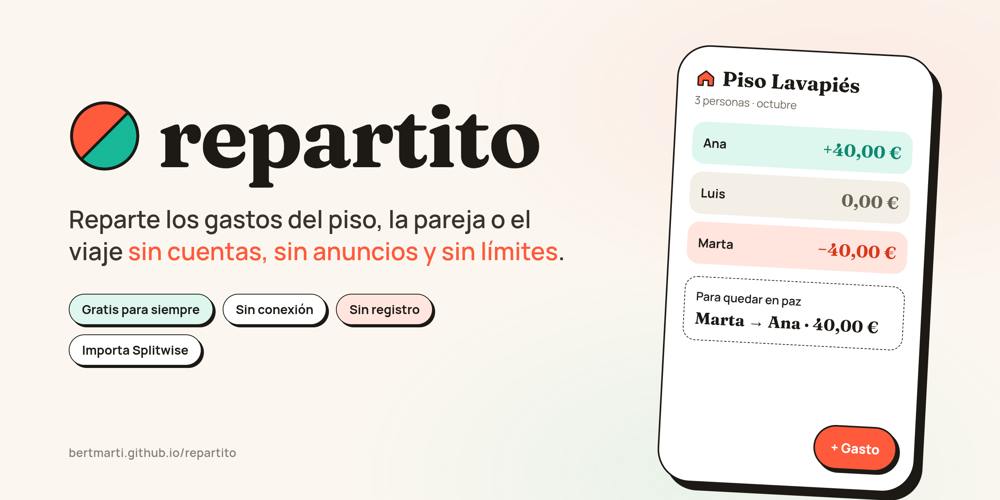
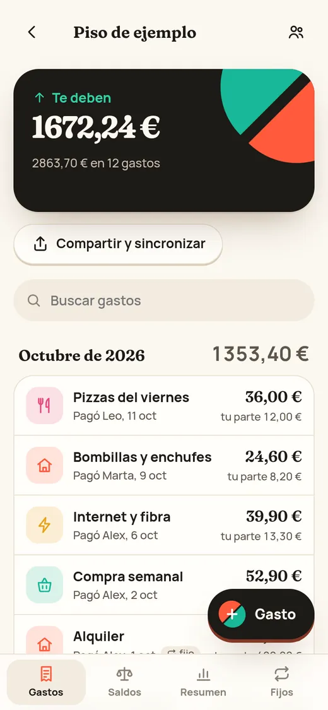
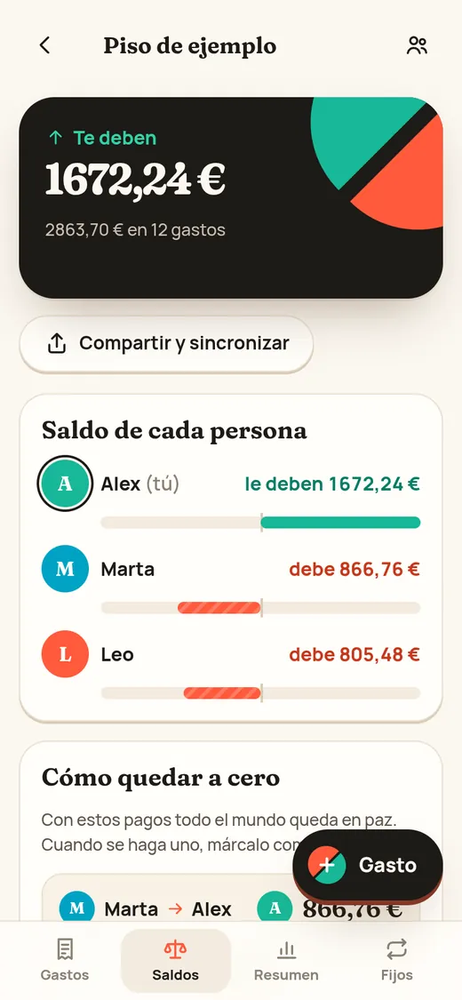
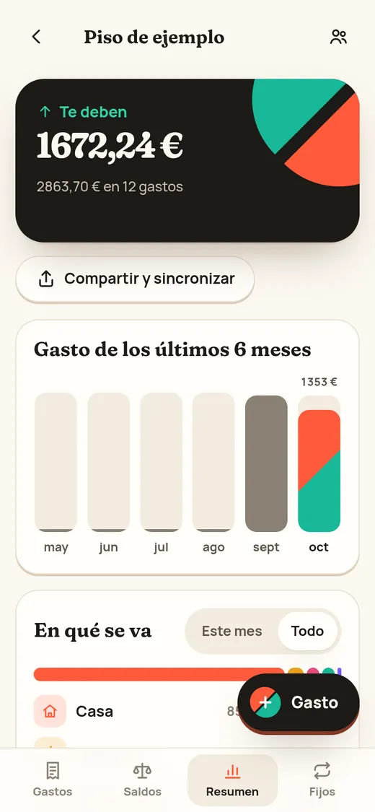
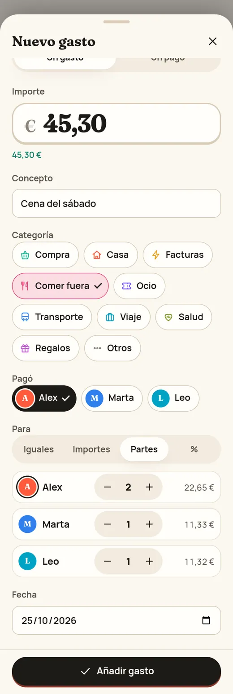
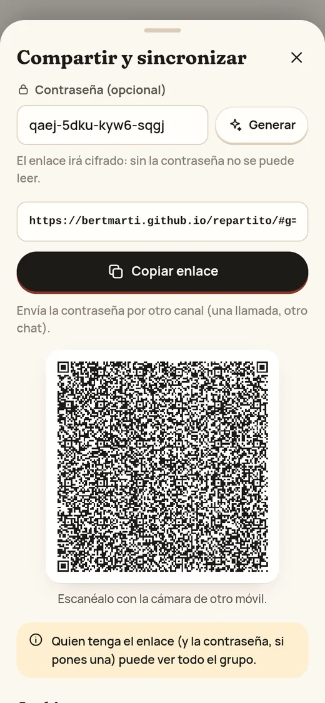
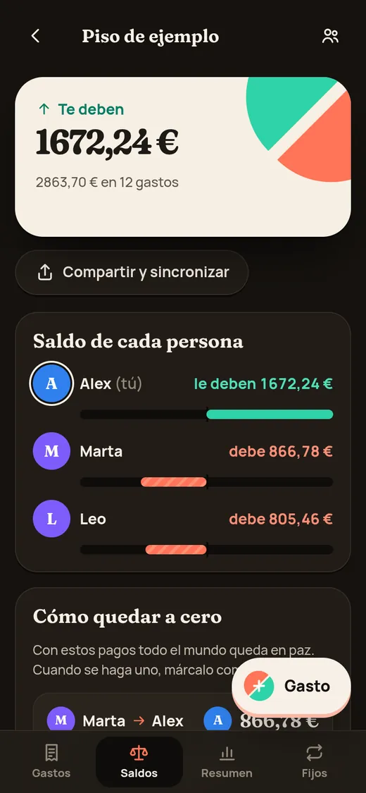

<p align="center">
  
</p>

<h3 align="center">Cuentas claras y el chocolate espeso.</h3>

<p align="center">
  <a href="https://bertmarti.github.io/repartito/"></a>
</p>

<p align="center">
  
  
  
  
  
  
</p>

---

## 🍫 ¿Qué es?

**Repartito** es la forma más sencilla de saber **quién debe qué** cuando compartes gastos: el súper del
piso, la luz, la cena del viernes o el viaje con amigos.

Apuntas lo que paga cada uno y la app hace las cuentas por ti: te dice cuánto te deben, cuánto debes y
**cómo quedar en paz con el menor número de pagos**.

Y sin trampas: **no tienes que crear una cuenta**, **no hay anuncios**, **no hay límite de gastos al día** y
**no hay versión de pago**. Funciona en el móvil y en el ordenador, también **sin conexión**.

<p align="center">
  
  &nbsp;
  
  &nbsp;
  
</p>

## ⚡ Cómo se usa (en un minuto)

1. **Abre** <https://bertmarti.github.io/repartito/> y toca **Nuevo grupo** (o **Probar con un grupo de ejemplo**
   para curiosear sin compromiso).
2. **Pon los nombres** de quienes compartís gastos y marca cuál eres tú.
3. Cada vez que alguien pague algo, toca **+ Gasto**: cuánto, qué es y quién lo pagó. Por defecto se reparte
   a partes iguales.
4. Mira la pestaña **Saldos**: verás cuánto debe cada uno y los pagos para quedar a cero. Cuando alguien
   pague (en efectivo, por Bizum o transferencia), toca **Marcar como pagado**. 🎉

## ✨ Lo que puedes hacer

<table>
  <tr>
    <td width="58%" valign="top">

**🧮 Repartir como queráis**<br>
A partes iguales, por importes, por partes (Alex pone doble porque su habitación es más grande) o por
porcentajes. Siempre cuadra **al céntimo**: nunca sobra ni falta nada.

**🔁 Gastos fijos que se apuntan solos**<br>
El alquiler, internet o una suscripción: dilo una vez y cada mes aparece solo el día que toca.

**🤝 Quedar en paz con el mínimo de pagos**<br>
Si sois cinco, no hacen falta veinte Bizums: la app calcula la forma más corta de saldar todo. Y si alguien
te debe, un toque en **Recordar** te deja un mensaje amable listo para WhatsApp.

**⚡ Apuntar en dos toques**<br>
**Repetir hoy** copia un gasto con la fecha de hoy, y las **plantillas** («Súper», «Bombona», «Luz») rellenan
el gasto por ti. Las plantillas se comparten con el grupo.

**✈️ De viaje, en la moneda de allí**<br>
¿La cena fue en yenes? Apúntala en yenes con el cambio que te dio el banco (la app recuerda el último) y la
cuenta del grupo sigue en euros.

**🧾 La foto del ticket**<br>
Adjunta una foto a cualquier gasto. Se queda **solo en tu móvil**: no viaja en los enlaces ni en las copias.

**📊 Saber en qué se va el dinero**<br>
Un resumen por meses y por categorías (súper, casa, facturas, ocio…).

**🌙 Bonita de día y de noche**<br>
Tema claro y oscuro, pensada para usarla con una mano.

**🗣️ En tu idioma**<br>
En español, catalán, gallego, portugués (de Portugal) e inglés. La primera vez habla el idioma de tu móvil;
lo cambias cuando quieras en **Ajustes**. El euskera llegará cuando lo revise alguien que lo hable.

  </td>
  <td width="42%" valign="top" align="center">
    
  </td>
  </tr>
</table>

## 📲 Compartir con tu gente (sin servidores)

Cada persona tiene **su propia copia** del grupo en su móvil. Para ponerse al día, una persona toca
**Compartir y sincronizar** y envía el **enlace** (o enseña el **código QR**) por WhatsApp, Telegram o como
quiera. Quien lo abre ve **exactamente qué cambiaría** y, si le parece bien, toca **Fusionar**: se juntan los
cambios de los dos, **sin perder nada y sin duplicar nada**.

<table>
  <tr>
    <td width="40%" align="center">
      
    </td>
    <td width="60%" valign="top">

- 🔐 **Contraseña opcional.** Toca **Generar** y la app crea una contraseña fuerte. Envíala por **otro
  camino** (en persona o por llamada): sin ella, el enlace es solo ruido.
- 👀 **Nada a escondidas.** Antes de fusionar ves los gastos nuevos, los cambiados y los borrados, las
  personas que entran o salen y si cambia la moneda. Lo delicado sale en rojo.
- 🛡️ **Si algo no cuadra, no entra.** Un enlace con fechas imposibles o que cambiaría los importes no se
  puede fusionar, y la app te dice por qué.
- 📁 **¿Prefieres un archivo?** También puedes descargar el grupo o exportarlo a Excel.

  </td>
  </tr>
</table>

## 🔒 Tus datos son tuyos

<table>
  <tr>
    <td width="60%" valign="top">

- **Se quedan en tu móvil.** No hay servidor de Repartito ni base de datos: tus gastos no viajan a ningún
  sitio salvo cuando **tú** compartes un enlace.
- **Sin cuentas, sin rastreo.** Ni registro, ni publicidad, ni analítica, ni cookies de terceros.
- **Blindada frente a enlaces malintencionados.** Todo lo que llega de fuera se revisa al detalle antes de
  tocar tus datos.
- **Revisada por un auditor independiente** antes de publicarla: todo lo que encontró está corregido.
- **Copia de seguridad** en un archivo cuando quieras, desde **Ajustes**.
- **Las fotos de los tickets no salen de tu móvil**: ni en los enlaces, ni en las copias, ni en el CSV.

  </td>
  <td width="40%" align="center">
    
  </td>
  </tr>
</table>

## 📱 Instálala en el móvil

### Android: la app

<p>
  <a href="https://github.com/BertMarti/repartito/releases/latest"></a>
</p>

1. Abre la [última versión](https://github.com/BertMarti/repartito/releases/latest) desde el móvil y descarga el
   archivo **`repartito-….apk`**.
2. Ábrelo. Si Android te avisa, permite instalar apps **de esta fuente** (solo para esta vez).
3. Listo: Repartito aparece con su icono, como cualquier otra app.

La app de Android es todavía **más privada** que la web: **no pide ningún permiso** (ni siquiera Internet),
sus datos no los puede leer ninguna web y **no se copian a la nube de Google**. Para cambiar de móvil, usa la
copia de seguridad de Ajustes.

### iPhone, Android u ordenador: desde el navegador

No hace falta tienda de aplicaciones:

- **iPhone (Safari):** botón **Compartir** → **Añadir a pantalla de inicio**.
- **Android (Chrome):** menú **⋮** → **Instalar aplicación** (o el botón **Instalar app** en Ajustes).
- **Ordenador (Chrome o Edge):** icono de instalar en la barra de direcciones.

Una vez instalada, se abre al momento y funciona **aunque no tengas cobertura**.

## 🔄 ¿Vienes de Splitwise?

1. En la web de Splitwise, abre el grupo y descarga la exportación en **CSV**.
2. En Repartito, toca **Abrir enlace o archivo** y elige ese archivo.
3. Listo: personas, gastos y **los mismos saldos** que tenías.

## ❓ Preguntas frecuentes

<details>
<summary><b>¿De verdad es gratis? ¿Dónde está la trampa?</b></summary>

No hay trampa: es un proyecto personal de código abierto. Al no tener servidores, mantenerla no cuesta
nada, así que no necesita anuncios ni suscripciones.
</details>

<details>
<summary><b>¿Qué pasa si borro el navegador o cambio de móvil?</b></summary>

Los datos viven en tu navegador. Antes de cambiar de móvil, descarga una **copia de seguridad** (Ajustes) o
pide a alguien del grupo que te envíe el enlace: al abrirlo, tendrás el grupo entero otra vez.
</details>

<details>
<summary><b>¿Y si dos personas apuntan gastos a la vez sin conexión?</b></summary>

No pasa nada. Cuando os enviéis el enlace, se juntan los gastos de las dos. Si los dos habéis editado el
mismo gasto, se queda la edición más reciente.
</details>

<details>
<summary><b>¿Quién puede ver mis gastos?</b></summary>

Solo quien tenga tu móvil o un enlace que hayas compartido (y su contraseña, si le pusiste una).
</details>

<details>
<summary><b>¿Por qué no le llegan a los demás las fotos de los tickets?</b></summary>

Porque las fotos se guardan solo en el móvil donde las haces: así nadie más ve tus tickets y los enlaces
siguen siendo pequeños. Si quieres enseñar una, mándala por el chat como cualquier otra foto. Ojo: la copia
de seguridad tampoco las incluye.
</details>

<details>
<summary><b>¿Funciona con otras monedas?</b></summary>

Sí: euros, dólares, libras, pesos, yenes y más. Cada grupo tiene su moneda y, en un viaje, cada gasto se puede
apuntar en la moneda del sitio con el cambio que tú le digas.
</details>

---

<details>
<summary><b>🛠️ Para curiosos y desarrolladores</b></summary>

Web estática (React + TypeScript) publicada en GitHub Pages, sin servidor propio, y la misma app empaquetada
para Android con Capacitor. La sincronización es una
fusión sin conflictos de las copias de cada persona; los enlaces van comprimidos y, con contraseña, cifrados
en el propio navegador.

- [Cómo funciona la sincronización](docs/SINCRONIZACION.md) · [App de Android](docs/ANDROID.md)
- [Arquitectura](docs/ARQUITECTURA.md)
- [Modelo de amenazas y auditoría](docs/MODELO_DE_AMENAZAS.md) · [Política de seguridad](SECURITY.md)
- [Plan](PLAN.md) · [Cambios](CHANGELOG.md) · [Cómo contribuir](CONTRIBUTING.md) · [Guía para agentes de IA](AGENTS.md)

```bash
npm ci
npm run dev      # desarrollo
npm run check    # lint + tipos + tests
npm run build    # versión publicable en dist/
npm run build:android && (cd android && ./gradlew assembleDebug)   # APK de Android
```

</details>

<p align="center">
  <sub>Hecho con 🍫 por <a href="https://github.com/BertMarti">BertMarti</a> · Licencia <a href="LICENSE">MIT</a></sub>
</p>
